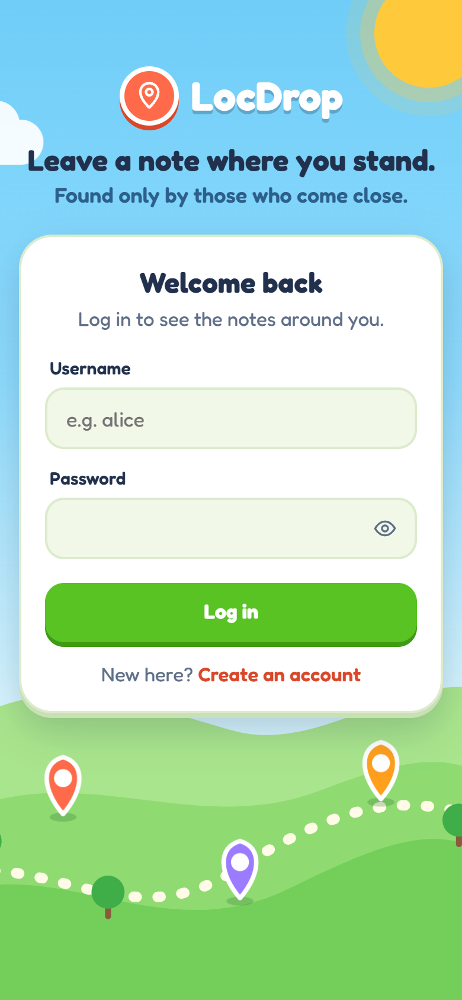
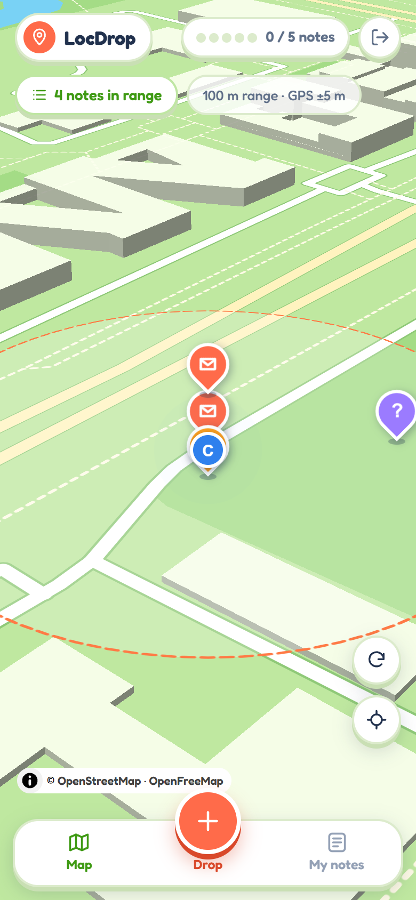
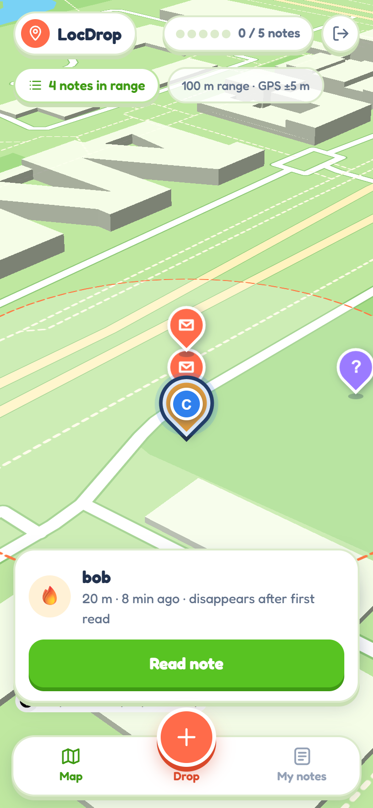
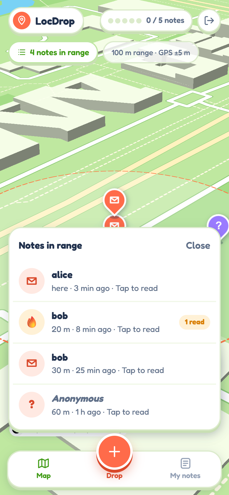
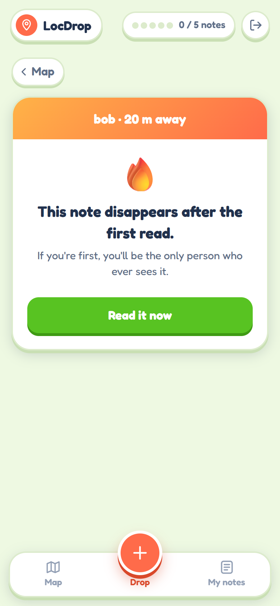
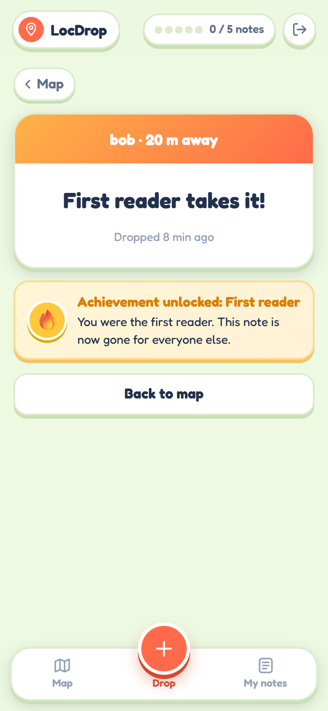
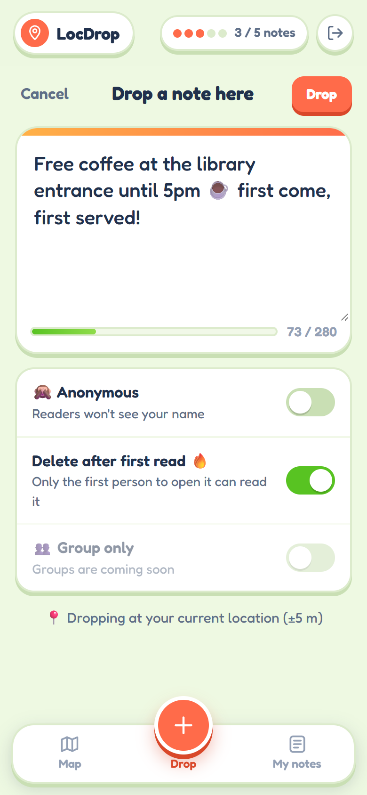
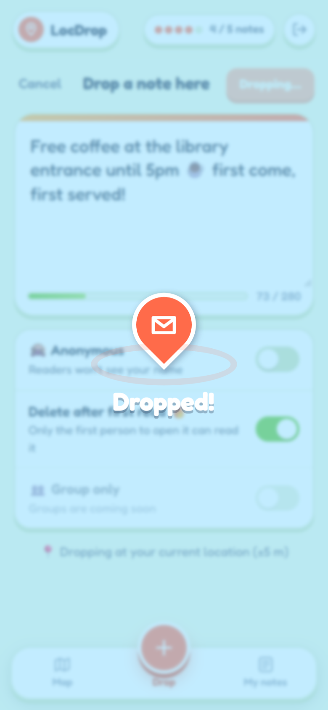
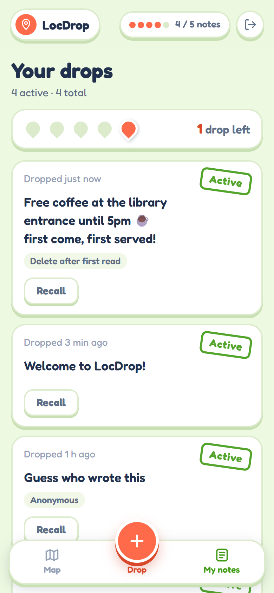
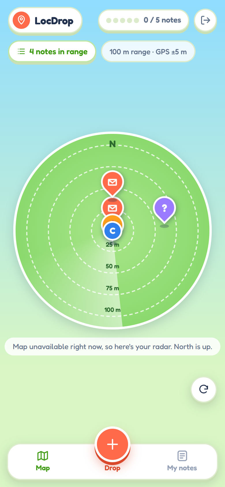

# LocDrop

> **Leave a note where you stand. Found only by those who come close.**

Leave short text notes at real-world locations. Only people standing nearby can read them.
CSC4160 Cloud Computing final project. The proposal (`CSC4160 Proposal-1.pdf`) defines the scope.

**Goals:**
- **Keep it lightweight.** Build exactly what the proposal asks for, plus live pop-ups.
- **Always online, so we can demo it any time.** Drop a note next to someone (e.g. an interviewer), and it pops up on their phone instantly without refreshing. Works anywhere in the world, not just on campus.

---

## Live app

| | Link |
|---|---|
| **Web app** (open on any phone) | **https://main.d26lfobsto0b1s.amplifyapp.com** |
| API | https://4v7x6bv0dk.execute-api.us-east-1.amazonaws.com |

Hosted on AWS (AWS Academy Learner Lab, `us-east-1`): web app on Amplify Hosting, API on API Gateway + Lambda, data in DynamoDB. **This link stops working when the course ends** (Learner Lab is wiped); see [Tech stack](#where-it-runs-in-the-cloud-and-why). Checked end to end with two phone-sized browsers and real GPS: drop → find nearby → first reader opens it → author sees "Read 🔥".

> **The live link still shows the previous design** until the redesign (branch `feat/redesign-adventure`) is merged and deployed. The demo script below describes the new design.

### 1-minute demo script (two phones, standing together)

1. **Phone A:** open the link → *Create account* → allow location. The **live map** opens, centred on you with your 100 m range ring.
2. **Phone A:** tap the big **+ Drop** button, write "Hi from LocDrop!", turn on **Delete after first read 🔥**, tap **Drop**. A pin drops ("Dropped!"); the header shows **1 / 5 notes**.
3. **Phone B:** open the link → *Create account* → allow location. A 🔥 **pin appears on the map** where Phone A is standing ("1 note in range").
4. **Phone B:** tap the pin → **Read note** → **Read it now**. The note opens with *"Achievement unlocked: First reader"*.
5. **Phone A:** **My notes** ("Your drops") shows the note stamped **Read 🔥**, and the counter is back to **0 / 5**.
6. *(Optional)* Walk more than 100 m away and open a note: *"Move a bit closer: this note is … m away."* The server, not the phone, decides.

Talking points: the server checks distance and permission on every read; the first-reader rule and the 5-note limit hold even with many simultaneous requests (benchmarks A-8 and B-7 in `backend/bench/results/`); geohash lookup stays fast as the table grows (B-8).

> Test the link right before a demo: from mainland China, connections to AWS `us-east-1` occasionally drop for a few minutes.

---

## Look & feel ("Daylight Adventure")

A game-like design inspired by location games such as Pokémon Go: sunny colours, a rounded font (Fredoka), chunky buttons you can "press", and a live map as the home screen.

| | |
|---|---|
| **Opening screen** | Animated landscape (drifting clouds, a walker on a trail, note pins dropping onto the hills) with the slogan |
| **Live map** | Tilted 3D street map in our own colours (no text labels, like a game map) that follows you as you walk. Your marker, a 100 m range ring, and **bobbing pins** for notes in range: ✉ normal, 🔥 delete after first read, purple **?** anonymous. Tap a pin for a preview card; the "x notes in range" chip opens a list |
| **Radar fallback** | If the map service can't load (e.g. blocked network), the app switches to a radar: you in the centre, range rings, and the same pins by real direction and distance |
| **Write note** | "Drop a note here", an ink bar that fills as you type, and a pin-drop animation when you tap **Drop** |
| **Open note** | Big note card with a sparkle burst; first readers get *"Achievement unlocked: First reader"* |
| **My notes** | "Your drops": your 5 slots as pins ("N drops left") and rubber-stamp statuses |

<table>
  <tr>
    <td align="center"><br>Opening screen</td>
    <td align="center"><br>Live map</td>
    <td align="center"><br>Tap a pin</td>
    <td align="center"><br>Notes in range</td>
  </tr>
  <tr>
    <td align="center"><br>"Read it now?"</td>
    <td align="center"><br>First reader</td>
    <td align="center"><br>Drop a note</td>
    <td align="center"><br>Dropped!</td>
  </tr>
  <tr>
    <td align="center"><br>Your drops</td>
    <td align="center"><br>Radar fallback</td>
    <td></td>
    <td></td>
  </tr>
</table>

Map data © [OpenStreetMap](https://www.openstreetmap.org/copyright) contributors, served free (no API key) by [OpenFreeMap](https://openfreemap.org) and drawn with [MapLibre GL JS](https://maplibre.org). The midterm-era screenshots are still in `docs/screenshots/`.

---

## Team

| Who | Does what |
|---|---|
| **Eugene** | Frontend (all screens) |
| **Vincent** | Backend part A: accounts, groups, writing notes, the N-note limit, live pop-ups |
| **Wendy** | Backend part B: finding nearby notes, reading notes, first-reader rule, recall. **Owns the GitHub repo** |

## Progress

| Step | Who | Status |
|---|---|---|
| 0a. Local setup (midterm) | Wendy (+ Eugene: S-7) | Done |
| 1. Midterm prototype, local only | Each person | Done (all four benchmarks run on one machine, results in `backend/bench/results/`) |
| 0b. AWS setup and deploy | Vincent | Done: **backend live on AWS** (Learner Lab, us-east-1; cloud smoke test 22/22, cloud user flow 16/16) |
| FE-9. Public web app link | Eugene (done by Vincent's session) | Done: web app on **AWS Amplify Hosting** (HTTPS, works on phones); see [Live app](#live-app) |
| Redesign ("Daylight Adventure", live map) | Eugene (frontend) + `api.md` change | Built and tested on branch `feat/redesign-adventure` (map walkthrough 23/23 with fake data and with a real backend; backend tests 61/61). **Waiting for:** all-three approval of the `api.md` change, PR review, then redeploy |
| 2. Rest of own part (groups, live pop-ups) | Each person | Not started |
| 3. Test with two phones on campus (F-2) | All | Not started |

---

## Midterm prototype (done)

> **Done.** This section is kept as a record of how the midterm was planned and built. For running the app today see [Run locally](#run-locally-from-a-fresh-clone) and [Live app](#live-app).

**Goal (met):** a working local prototype by **Saturday night**, plus benchmark results (CSV files + summary tables) for the midterm report. No AWS before the midterm.

### How it runs locally

```
Browser (localhost:5173)
   │  HTTP
   ▼
Local Express server (localhost:3000)    backend/src/local/server.ts
   │  turns each request into an API Gateway event and calls the handler
   ▼
Our Lambda handlers (unchanged code)     backend/src/auth, notes-write, notes-read, ...
   │  real AWS SDK v3, dummy credentials
   ▼
DynamoDB Local in Docker (localhost:8000)
```

Moving to AWS later only changes configuration: the code detects Lambda automatically and talks to real DynamoDB. No handler code changes.

### Phase 0a / 0b

| Phase | When | What | Who |
|---|---|---|---|
| **0a** | Friday night | S-1, S-2, S-4, S-5, S-6, S-8: all shared backend code, generated in one session (`docs/prompts/phase0a-wendy.md`) | Wendy |
| **0a** | Friday night, in parallel | S-7: frontend project + fake API data | Eugene |
| **0a** | Friday night | Install tools (`docs/SETUP.md`); review `api.md` and Wendy's PR | Vincent |
| **0b** | After the midterm (done) | S-3: `template.yaml`, AWS SAM, deploy (to AWS Academy Learner Lab; see [Tech stack](#tech-stack)) | Vincent |

> For the midterm, Wendy's Phase 0a session generates S-2, S-5 and S-6 (normally Vincent's) so all shared code comes from one place. Vincent owns `slots/` and `auth/` from Saturday on.

### Midterm checklist

**Phase 0a (Friday night)**
- [x] **S-1** @Wendy Create the GitHub repo; first commit = `README.md`, `api.md`, `docs/`
- [x] **S-2** @all Approve `api.md` (already drafted)
- [x] **S-4** @Wendy Shared helpers: config, database, geohash + distance, HTTP responses
- [x] **S-5** @Wendy Shared login check (`withAuth`) + password hashing
- [x] **S-6** @Wendy `slots/index.ts` (working `reserveSlot` / `releaseSlot`) and `groups/membership.ts` (`isMember` always returns `false` for now)
- [x] **S-7** @Eugene Frontend project + fake API data for every endpoint
- [x] **S-8** @Wendy Local dev server, DynamoDB Local `docker-compose.yml`, create-table script, seed script, benchmark helpers

**Saturday: Frontend (@Eugene)**
- [x] **FE-1** Register and login screens
- [x] **FE-2** Get the phone's location; handle "permission denied"
- [x] **FE-3** Nearby screen *(since the redesign: the live map with pins; see [Look & feel](#look--feel-daylight-adventure))*
- [x] **FE-4** Open a note
- [x] **FE-5** Write note screen (group option shown as "coming soon")
- [x] **FE-6** "x of N notes used"
- [x] **FE-7** My notes screen with Recall
- [x] **FE-11** *(new)* Dev-only location override panel (fake your location without walking)

**Saturday: Backend part A (@Vincent)**
- [x] **A-1** Register · **A-2** Login · **A-3** `GET /me`
- [x] **A-5** Own and test `reserveSlot` / `releaseSlot`
- [x] **A-6** Write note · **A-7** `GET /notes/mine`
- [x] **A-8** N-limit benchmark: naive vs conditional write
- [x] **L-1** *(new)* Latency table: p50/p95 for every implemented endpoint

**Saturday: Backend part B (@Wendy)**
- [x] **B-1** Nearby lookup (9 geohash cells) · **B-2** Exact distance check
- [x] **B-3** Permission check: **public + anonymous only** for now
- [x] **B-4** Open note · **B-5** First-reader rule · **B-6** Recall
- [x] **B-7** First-reader benchmark
- [x] **B-8** *(new)* Nearby benchmark: geohash vs full-table scan at 1k / 10k / 50k notes, plus a cell-edge correctness test

**Deferred until after the midterm:** S-3 *(now done)*, A-4, A-9, A-10, FE-8, FE-9 *(now done)*, FE-10, group permissions.

### Benchmarks (evidence for the report)

All results go to `backend/bench/results/` as a raw CSV + a `*-summary.md` with a ready-to-paste table. **Run the final versions on one machine** so the numbers are comparable.

| ID | Owner | Experiment | Expected result | Chart for the report |
|---|---|---|---|---|
| A-8 | Vincent | 50 simultaneous "write note" requests from one user, N = 5, 20 runs; naive vs conditional write | Conditional: exactly 5 every run. Naive: more than 5 | Bar chart: successes per run, both versions, line at N = 5 |
| B-7 | Wendy | 20 simultaneous opens of one "delete after first read" note, 20 runs | Exactly 1 text and 1 slot release every run | Bar chart: texts returned per run |
| B-8 | Wendy | Nearby query latency and items examined: geohash 9-cell vs full scan, 1k / 10k / 50k notes | Geohash stays flat; scan grows with table size; same results | Line chart: latency and items examined vs table size |
| L-1 | Vincent | p50 / p95 latency per endpoint, local | Register and login are slowest (password hashing) | Table |

### Saturday timeline

| Time | Eugene | Vincent | Wendy |
|---|---|---|---|
| 09:00 | Pull `main`, run app in mock mode | Pull `main`, run `npm test` | Pull `main`, run `npm test` |
| 09:00–12:00 | FE-1, FE-2, FE-3 (mock mode) | A-1, A-2, A-3 | B-1, B-2, B-3 |
| 12:00–13:00 | Lunch | Lunch | Lunch |
| 13:00–16:00 | FE-4, FE-5, FE-6, FE-7, FE-11 | A-6, A-7, A-5 tests | B-4, B-5, B-6 |
| 16:00–18:00 | Switch to the real local backend; fix mismatches | A-8 naive version + benchmark | B-7 benchmark |
| 18:00–20:00 | Screenshots of each screen for the report | L-1 latency table | B-8 benchmark |
| 20:00–22:00 | **Together:** merge everything, run all benchmarks on one machine, commit `bench/results/` | ← | ← |

Kickoff prompts: `docs/prompts/saturday-eugene.md`, `saturday-vincent.md`, `saturday-wendy.md`.

### Run locally (from a fresh clone)

Install the tools first: see [`docs/SETUP.md`](docs/SETUP.md).

```powershell
git clone https://github.com/christohartanto/LocDrop.git
cd LocDrop
npm run setup            # installs backend + frontend packages

npm run db:up            # start DynamoDB Local in Docker
npm run db:init          # create the table
npm run seed             # demo users (alice / bob / carol, password "password123") + notes

npm run dev:api          # terminal 1: API on http://localhost:3000
npm run dev:web          # terminal 2: app on http://localhost:5173 (uses the real local API)
npm run dev:web:mock     # or: app with fake data, no backend needed
npm run dev:web:phone    # or: open it on your phone (same Wi-Fi, HTTPS, real GPS); see docs/SETUP.md

npm test                 # backend tests (needs DynamoDB Local running)
```

Benchmarks (start `npm run dev:api:quiet` in another terminal first, except B-8):

```powershell
npm run bench:a8
npm run bench:b7
npm run bench:b8         # no API server needed; uses its own table
npm run bench:latency
```

DynamoDB Local keeps data **in memory**. After restarting Docker, run `npm run db:init` and `npm run seed` again.

### Use the cloud backend from your laptop

The app on your laptop can talk to the AWS backend instead of the local one (no Docker needed):

```powershell
$env:VITE_API_URL="https://4v7x6bv0dk.execute-api.us-east-1.amazonaws.com"
npm run dev:web
```

The cloud database is separate from your local one: register a new account there (alice/bob/carol only exist locally).

### Deploy to AWS

Full guide: [`docs/DEPLOY.md`](docs/DEPLOY.md). Deploy from an up-to-date `main`, so the cloud always matches `main`.

```powershell
# AWS Academy Learner Lab (current setup): Start Lab → AWS Details → copy the [default] keys into ~/.aws/credentials, then:
npm run deploy -- --learner-lab            # backend + web app (Amplify), region us-east-1
npm run smoke:aws -- --learner-lab         # check every endpoint in the cloud
```

---

## Tech stack

- **Frontend:** React + Vite + TypeScript, "Daylight Adventure" theme (Fredoka font). In the cloud it's hosted on **AWS Amplify Hosting** (HTTPS, which phones need for GPS). The template can also host it on **S3 + CloudFront** instead (see below).
- **Map:** [MapLibre GL JS](https://maplibre.org) with OpenStreetMap data from [OpenFreeMap](https://openfreemap.org) (free, no API key), drawn in our own style (`frontend/src/map/style.ts`). If the map service can't be reached, the app falls back to a radar view that needs no map data.
- **Backend:** 11 **AWS Lambda** functions (Node.js 22, TypeScript, one per endpoint) behind an **API Gateway HTTP API**, rate-limited to cap costs
- **Database:** **DynamoDB**, one table, on-demand billing; a geohash index finds nearby notes
- **Login secret:** random, stored in **SSM Parameter Store**, never in git
- **Infrastructure as code:** everything is described in [`backend/template.yaml`](backend/template.yaml) (AWS SAM) and deployed with **one command** (`npm run deploy`; only the AWS CLI is needed). See [`docs/DEPLOY.md`](docs/DEPLOY.md).
- **Live pop-ups (planned, A-9/A-10/FE-10):** API Gateway WebSocket API, triggered by DynamoDB Streams
- **Local development:** Express server that calls the same Lambda handlers, plus DynamoDB Local in Docker

Serverless means no server to keep running: the app stays online 24/7 and costs about $0/month at our usage.

### Where it runs in the cloud (and why)

```
Phone / laptop browser
   │ HTTPS
   ├──▶ AWS Amplify Hosting ............ the web app (static files)
   │
   └──▶ API Gateway (HTTP API) ......... https://<id>.execute-api.us-east-1.amazonaws.com
          │
          ▼
        11 Lambda functions ............ same handler code as local (src/auth, notes-write, notes-read, ...)
          │
          ▼
        DynamoDB table "locdrop-prod" .. users + notes (+ SSM Parameter Store for the login secret)
```

| Decision | Why |
|---|---|
| **AWS Academy Learner Lab, region `us-east-1`** (for the course) | Our "Make It Happen" AWS account sits inside an AWS Organization that **blocks Lambda**. Learner Lab allows Lambda through its ready-made **`LabRole`**, so `npm run deploy -- --learner-lab` uses that role (Learner Lab can't create new roles) |
| **Amplify Hosting instead of CloudFront** (in Learner Lab) | Learner Lab **blocks CloudFront**. Amplify gives the same thing we need, an HTTPS link served from AWS's CDN (it runs on CloudFront behind the scenes, managed by AWS). The template supports both: `--website=amplify` or `--website=cloudfront` |
| **Move to a personal AWS account later** | Learner Lab **deletes everything when the course ends**, so the link won't last. Same template and command, without `--learner-lab`. New accounts need AWS Support to verify them before using CloudFront; Amplify works right away |

**Learner Lab facts:**
- The keys on the laptop expire with each ~4-hour lab session. That only matters for **deploying**.
- **The live app keeps running between sessions.** We checked after a session ended: the API and database still answered.

Settings (in `backend/src/shared/config.ts`):

| Setting | Default |
|---|---|
| Max active notes per user (N) | 5 |
| Read radius | 100 m |
| Max note length | 280 characters |

---

## Folders: who owns what

Only edit your own folders. Shared folders change only with everyone's agreement.

```
locdrop/
├── api.md                    # SHARED: the API contract
├── docker-compose.yml        # SHARED: DynamoDB Local
├── package.json              # SHARED: root scripts
├── docs/                     # SHARED: setup guide (SETUP.md), deploy guide (DEPLOY.md), data model, design references, AI prompts, screenshots
├── frontend/                 # Eugene (src/map/ = live map, map style, pins, radar fallback)
└── backend/
    ├── template.yaml         # SHARED (Vincent): all AWS resources (DynamoDB, Lambda, API, Amplify or S3+CloudFront)
    ├── scripts/              # SHARED: create table, seed, token, smoke test (local + smoke-aws),
    │                         #         build-lambdas, deploy, lambdas.ts (which handler = which Lambda)
    ├── .aws-build/           # generated by the deploy (bundled Lambdas, outputs.json); git-ignored
    ├── bench/
    │   ├── lib/              # SHARED: benchmark helpers
    │   ├── a8/               # Vincent
    │   ├── latency/          # Vincent
    │   ├── b7/               # Wendy
    │   ├── b8/               # Wendy
    │   └── results/          # benchmark output (each person writes only their own files)
    ├── tests/
    │   ├── shared/           # SHARED
    │   ├── slice-a/          # Vincent
    │   └── slice-b/          # Wendy
    └── src/
        ├── shared/           # SHARED: config, database helpers, geo/distance helpers, login check
        ├── local/            # SHARED: local Express server
        ├── auth/             # Vincent
        ├── groups/           # Vincent
        ├── notes-write/      # Vincent
        ├── slots/            # Vincent: the only code that changes a user's note count
        ├── realtime/         # Vincent: WebSocket connections + live pop-ups
        ├── notes-read/       # Wendy
        └── notes-lifecycle/  # Wendy
```

---

## API endpoints

Full request/response formats: **[`api.md`](api.md)**.
Eugene builds the screens against fake (mock) data that matches `api.md`, so the frontend doesn't wait for the backend.
All endpoints except register and login need a login token.

| Endpoint | Owner | What it does |
|---|---|---|
| `POST /auth/register` | Vincent | Create an account (username + password, no email) |
| `POST /auth/login` | Vincent | Log in, get a token |
| `GET /me` | Vincent | Username and "x of N notes used" |
| `POST /groups` | Vincent | Create a group, get a join code |
| `POST /groups/join` | Vincent | Join a group with a code |
| `GET /groups` | Vincent | List my groups |
| `POST /notes` | Vincent | Write a note at my location |
| `GET /notes/mine` | Vincent | List my notes and their status |
| `GET /notes/nearby?lat=&lng=` | Wendy | List notes near me (no text yet) |
| `POST /notes/{id}/open` | Wendy | Read a note (server checks I'm close enough) |
| `DELETE /notes/{id}` | Wendy | Recall (delete) my own note |

Errors always look like `{ "error": { "code": "NOTE_LIMIT_REACHED", "message": "..." } }`.
Error codes: `VALIDATION_ERROR`, `UNAUTHENTICATED`, `INVALID_CREDENTIALS`, `USERNAME_TAKEN`, `NOT_GROUP_MEMBER`, `NOTE_LIMIT_REACHED`, `OUT_OF_RANGE`, `NOT_FOUND`, `NOTE_GONE`, `INTERNAL`, `NOT_IMPLEMENTED`.

### Live pop-ups (WebSocket)

The app opens one WebSocket connection after login: `wss://.../?token=<login token>`.

| Direction | Message | Meaning |
|---|---|---|
| Phone → server | `{ "action": "location", "lat": ..., "lng": ... }` | "I'm here." Sent on connect and whenever I move more than ~20 m |
| Server → phone | `{ "type": "note_nearby", "note": { ...same as one item from /notes/nearby } }` | A new note was just dropped within range, and I'm allowed to see it |
| Server → phone | `{ "type": "note_gone", "id": "..." }` | A note in my list was read (first-reader rule) or recalled; remove it |

The pop-up only says a note is there. To read it, the app still calls `POST /notes/{id}/open`, so the distance and permission checks stay on the server.

How it works: a separate `notify` function in `realtime/` is triggered automatically whenever a note is added or removed in the database (DynamoDB Streams). Vincent's and Wendy's note code doesn't need to call it.

### The one place Vincent's and Wendy's code meet

When Wendy's code removes a note (first reader or recall), the author gets a slot back. Vincent's code owns the slot count, so:

- `slots/index.ts` has `reserveSlot(username)` and `releaseSlot(username)` (Vincent owns it).
- Wendy **calls** `releaseSlot`, but never edits it.
- Wendy also calls Vincent's `isMember(username, groupId)` to check group notes.

These function names are fixed in Phase 0a, so nobody needs to touch the other person's files.

---

## Checklist (full project)

Tick your box in the same pull request that finishes the item.

### 1. Setup (together, first)

- [x] **S-1** @Wendy Create the GitHub repo, add Eugene and Vincent, turn on branch protection
- [x] **S-2** @Vincent Write `api.md` with the request and response for every endpoint (everyone approves)
- [x] **S-3** @Vincent `template.yaml` with every endpoint and the WebSocket API created as empty placeholders *(done and deployed; the WebSocket API moves to A-9, together with the live pop-up code)*
- [x] **S-4** @Wendy Shared helpers: config, database table layout, geohash + distance functions
- [x] **S-5** @Vincent Shared login check that every protected endpoint uses
- [x] **S-6** @Vincent Empty versions of `releaseSlot`, `reserveSlot`, `isMember` so Wendy can start
- [x] **S-7** @Eugene Frontend project + fake API data for every endpoint
- [x] **S-8** @Wendy Local dev server, DynamoDB Local, create-table and seed scripts, benchmark helpers

### 2. Frontend (@Eugene)

- [x] **FE-1** Register and login screens (no email)
- [x] **FE-2** Get the phone's location; handle "permission denied"
- [x] **FE-3** Nearby screen: list of notes near me with distance, author (or "Anonymous") and group *(redesigned as a live map: pins for notes in range, plus a list)*
- [x] **FE-4** Open a note: send current location, show only what the server returns, handle "too far" and "already gone"
- [ ] **FE-5** Write note screen: text, public or group, anonymous on/off, "delete after first read" on/off
- [x] **FE-6** Show "x of N notes used"; block writing when full
- [x] **FE-7** My notes screen with a Recall button
- [ ] **FE-8** Groups screen: create, join with code, list
- [x] **FE-9** Works well on a phone screen; deploy to S3 + CloudFront *(deployed on **AWS Amplify Hosting**, since Learner Lab blocks CloudFront; HTTPS, real GPS works. See [Live app](#live-app))*
- [ ] **FE-10** Live pop-ups: connect to the WebSocket, send location when moving, show a "New note nearby!" pop-up and add or remove notes in the list; reconnect automatically if the connection drops
- [x] **FE-11** Dev-only location override panel

### 3. Backend part A (@Vincent)

- [x] **A-1** Register: unique username, hashed password, no email
- [x] **A-2** Login: returns a token
- [x] **A-3** `GET /me`
- [ ] **A-4** Groups: create, join with code, list; `isMember` function
- [x] **A-5** Slot count: `reserveSlot` only succeeds if the user has fewer than N notes; `releaseSlot` gives one back. Both use DynamoDB conditional writes
- [x] **A-6** Write note: check group membership, save location + geohash, reserve a slot in the same transaction
- [x] **A-7** `GET /notes/mine`
- [x] **A-8** **Concurrency test:** one user sends 50 "write note" requests at once with N = 5 → exactly 5 succeed (compare with a naive version)
- [ ] **A-9** WebSocket connect / disconnect / location: check the login token, save each connection with its geohash area, delete it on disconnect
- [ ] **A-10** `notify` function (triggered by DynamoDB Streams): when a note is added, push `note_nearby` to connections in range that are allowed to see it (same distance + group rules as B-2/B-3); when a note is removed, push `note_gone`. Skip the author's own connection
- [x] **L-1** Latency table for every endpoint

### 4. Backend part B (@Wendy)

- [x] **B-1** Nearby: look up notes in my geohash area + the 8 areas around it
- [x] **B-2** Exact distance check on the server; only return notes within the radius
- [ ] **B-3** Permission check: public notes, or group notes only if I'm a member; hide the author name on anonymous notes
- [x] **B-4** Open note: re-check permission and distance on **every** read, then return the text
- [x] **B-5** First-reader rule: if "delete after first read" is on, only the first reader gets the text; the note is removed and the author's slot is released in the same transaction
- [x] **B-6** Recall: only the author can recall; the note is removed and the slot released
- [x] **B-7** **Concurrency test:** 20 people open the same "delete after first read" note at once → exactly 1 gets the text, and the slot is released exactly once
- [x] **B-8** Nearby benchmark: geohash vs full-table scan, plus a cell-edge correctness test

### 5. Finish (together)

- [x] **F-1** Point the frontend at the real backend *(the live app uses the AWS backend)*
- [ ] **F-2** Test with two phones: write → note pops up on the other phone → open → first-reader delete (disappears from both) → recall
- [x] **F-3** Save the concurrency test results for the report *(`backend/bench/results/`)*
- [x] **F-4** Write a short "Demo" section in this README with the live link and a 1-minute demo script *(see [Live app](#live-app))*

---

## GitHub rules

**Wendy owns the repo** (admin). Eugene and Vincent are collaborators.

1. **Never push to `main` directly.** Make a branch: `feat/A-5-slot-count`, `feat/FE-3-nearby`, etc.
2. **Open a pull request** and get one approval:
   - Vincent's PRs → Wendy reviews
   - Wendy's PRs → Vincent reviews
   - Eugene's PRs → Wendy or Vincent
   - Changes to shared files (`api.md`, `shared/`, `local/`, `scripts/`, `bench/lib/`, `template.yaml`) → **all three** approve
3. **Before merging:** pull the latest `main` into your branch and make sure it still works.
4. **Merge with "Squash and merge".**
5. **Commit messages** start with the checklist ID: `A-5: add slot limit check`.
6. **Tracking:** one GitHub Issue per checklist item (title like `[B-5] First-reader rule`). Write `Closes #12` in the PR so the Issue closes when it merges.
7. **Deploy only from `main`,** after merging, so what's live on AWS always matches `main`.

> **Note:** On a free GitHub account, branch protection doesn't work on **private** repos. Wendy can get free GitHub Pro through the [GitHub Student Developer Pack](https://education.github.com/pack), or the repo can be public. Otherwise, follow rule 1 on trust.

### When is something "done"?

- **Endpoint:** matches `api.md`, checks login, rejects bad input, has a basic test.
- **Screen:** works with fake data and the real backend, shows loading and error messages, works on a phone.
- **Test:** runs and passes; concurrency results saved.

### Using AI assistants

Tell your AI at the start of each session:

> I am working on LocDrop as **[name]**. Only edit files in **[my folders from the table above]**. Do not edit `api.md`, `backend/src/shared/`, `template.yaml`, or anyone else's folder. If a change there is needed, stop and tell me instead.

Ready-made prompts are in `docs/prompts/`.

---

## Assumptions

- N and the read radius are the same for everyone (settings above).
- "Delete after first read" is an option the author picks per note. The author opening their own note doesn't count.
- Anonymous only hides the name from readers. The server still knows the author, so recall works.
- A group is a set of people who joined with a code.
- The map shows notes **within 100 m** as pins at their real position, with distance and author, but not the text. Text appears only after opening (and the server checks distance again then). Notes farther away are never sent, so the map can't reveal them. *(Added with the redesign: `api.md` `NoteSummary` gained `lat`/`lng`.)*

## Open questions (decide as a team)

1. Is "join with a code" the right way to do groups?
2. Should "delete after first read" be optional per note, or apply to every note?
3. One radius for all notes, or can each note have its own?
4. Should people see that a note exists before they open it?
5. ~~Which AWS account hosts the app?~~ **Decided for the course:** AWS Academy Learner Lab (our "Make It Happen" account can't be used: its AWS Organization blocks Lambda). **Still open for later:** whose **personal** AWS account hosts it long-term, before the course ends and Learner Lab is wiped? (Set a Zero spend budget first.)
6. Do we want a custom domain (e.g. `locdrop.xyz`, about $10/year)? It would also keep the link the same when we move from Learner Lab to a personal account.
7. **Connection from mainland China:** during testing, the connection from Shenzhen to AWS `us-east-1` sometimes dropped for a few minutes (likely VPN/routing). Test before every demo. When moving to a personal account, consider a closer region (Singapore, Tokyo) if the account allows it.
8. **Map data from mainland China:** the map tiles come from OpenFreeMap (outside China). If they're blocked or slow on some networks, the app shows the radar instead, which still works. For a China-first demo, a China-friendly map provider could be added later.
